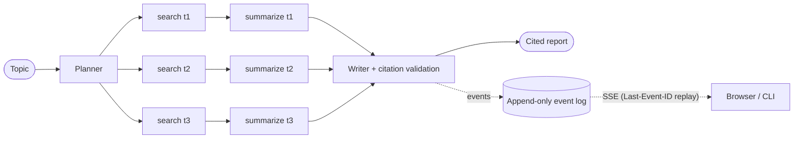
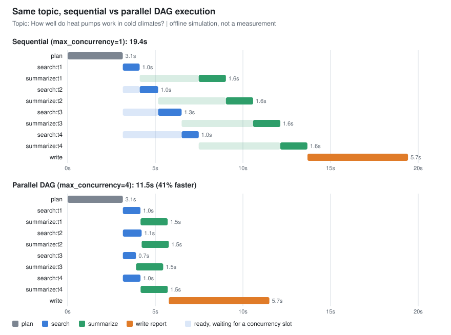

# Async Agentic Research & Evaluation Pipeline

[](https://github.com/Dong79/async-research-pipeline/actions/workflows/ci.yml)


A multi-agent "deep research" service: give it a topic, it plans sub-questions, searches and
summarizes them **in parallel** as an async DAG, streams progress and the report over
**Server-Sent Events**, checkpoints every step so interrupted runs resume, and ships with an
**LLM-as-a-Judge harness** that audits whether each claim in the report is actually supported
by the source it cites.

**Measured results** (real LLM and web search; details in [Results](#results)):

- **−45% end-to-end latency** from parallel DAG execution vs. sequential (mean 70.3 s → 38.8 s, n=10)
- **Unsupported claims 22.1% → 4.1%** (−80% relative, 95% CI 65–90%, n=30 queries, ~2,400 judged claims)
- **Uncited factual claims per report 8.9 → 0.5**; citation precision 87% → 93%

Inspired by the TODO-driven research agent in [hello-agents ch.14](https://github.com/datawhalechina/hello-agents/blob/main/docs/chapter14/%E7%AC%AC%E5%8D%81%E5%9B%9B%E7%AB%A0%20%E8%87%AA%E5%8A%A8%E5%8C%96%E6%B7%B1%E5%BA%A6%E7%A0%94%E7%A9%B6%E6%99%BA%E8%83%BD%E4%BD%93.md),
re-designed around concurrency, resilience and measurable grounding. No agent framework —
just `asyncio`, FastAPI, httpx and Pydantic, so every mechanism is visible in ~3k lines.



Each node starts as soon as its own dependencies finish, with at most K nodes in flight,
retries with backoff, token budgets, and a checkpoint after every node.

## Features

| Area | What it does | Where |
|---|---|---|
| DAG execution | Readiness-driven scheduler: a node starts as soon as *its* deps finish; bounded by a semaphore; optional nodes degrade instead of failing the run; fail-fast cancellation | `dag.py` |
| Resilience | Exponential backoff with full jitter, `Retry-After` support, retryable vs permanent error classes, per-provider concurrency caps, safe retry for streams (only before first token), automatic adaptation to models that reject `max_tokens`/`temperature` | `retry.py`, `llm.py`, `search.py` |
| Retrieval | Keyless web search (DuckDuckGo metasearch) + concurrent full-page fetching and text extraction; Tavily optional | `search.py`, `web.py` |
| Context budgets | URL + content dedupe, BM25 ranking of sources *and* of passages within each page, per-source caps, greedy fill to a token budget; fair (water-filling) budget split for the writer | `budget.py` |
| Grounding | Local→global citation remapping across sub-tasks, strict citation prompts, post-hoc validation of citation ids, canonical reference list | `citations.py`, `prompts.py` |
| Streaming | Background run + append-only event log → many SSE subscribers, reconnect with `Last-Event-ID`, heartbeats, token streaming of the report | `runs.py`, `api.py` |
| Checkpointing | Atomic per-node state writes; resume after crash/restart re-runs only unfinished nodes | `checkpoint.py` |
| Evaluation | 100-query benchmark set (results on a stratified 30-query sample), claim-level LLM judge, baseline vs grounded A/B with paired bootstrap CI, human-agreement (Cohen's κ) tooling, latency ablation | `judge.py`, `eval/` |
| Observability | Per-node execution spans (queued / start / end): live Gantt chart in the web UI, text timeline in the CLI, SVG export | `timeline.py`, `static/index.html` |
| Offline mode | Deterministic fake LLM + search with realistic latency and injectable 429s — tests and CI need no keys | `llm.py`, `search.py` |

## Quick start

```bash
python -m venv .venv && source .venv/bin/activate      # Windows: .venv\Scripts\activate
pip install -e ".[dev,tokens]"

# 1) Offline demo, no API keys
make demo            # open http://localhost:8000

# 2) Real LLM + real web search (only an LLM key is needed)
cp .env.example .env                 # Windows: copy .env.example .env  — then paste LLM_API_KEY
research-run --check                 # verifies key, model and search; explains any failure
research-run "How are small modular reactors being deployed?"   # streams, saves report.md
research-server                      # web UI on http://localhost:8000
```

Any OpenAI-compatible provider works (OpenAI, DeepSeek, Qwen, OpenRouter, Ollama...): set
`LLM_BASE_URL` and `LLM_MODEL` in `.env`. Use a non-reasoning chat model.

## Execution timeline



Every run records when each node became ready, started and finished. Overlapping bars ran
concurrently; the pale segment before a bar is time spent **ready but waiting for a
concurrency slot**. The write step can only start after the last summary, so its length bounds
the possible speed-up (Amdahl's law), which is why the measured gain is ~45% rather than ~75%.

The chart above comes from an offline simulation. To draw it from a real run (two reports'
worth of API calls):

```bash
python -m eval.timeline "How well do heat pumps work in cold climates?"   # writes docs/timeline.svg
research-run "..." --timeline-svg timeline.svg                           # timeline of a single run
```

The web UI draws the same chart live while a run executes.

### API

```bash
curl -X POST localhost:8000/api/runs -H 'content-type: application/json' \
     -d '{"topic": "How are small modular reactors being deployed?"}'
# -> 202 {"id": "3f2c...", "events_url": "/api/runs/3f2c.../events", ...}

curl -N localhost:8000/api/runs/3f2c.../events                       # live SSE
curl -N -H 'Last-Event-ID: 42' localhost:8000/api/runs/3f2c.../events # replay from event 43
curl -X POST localhost:8000/api/runs/3f2c.../resume                    # resume failed/interrupted run
```

Event types: `run_started, stage, plan, span, task_status, pages_fetched, context_pruned, retry,
task_summary, writer_context, report_delta, report, done | error`.

## Evaluation

```bash
python -m eval.run_eval --queries eval/queries_30.jsonl   # reported results: 30 queries, 6 per domain avg.
make eval    # python -m eval.run_eval --limit 100     (full set: baseline vs grounded, judged per claim)
make bench   # python -m eval.benchmark --limit 10      (sequential vs DAG vs DAG+pruning)
python -m eval.run_eval --export-sample 60              # blind CSV for human labels
python -m eval.agreement eval/results/human_label_sample.csv
```

**Grounding metric.** The report is split into sentence-level claims. For each claim the judge
sees *only the excerpts of the sources that claim cites* and labels it `supported`,
`partially_supported`, `unsupported` (incl. factual claims with no citation) or `not_a_claim`.
*Unsupported-claim rate* = unsupported / (claims excluding `not_a_claim`). Both modes share the
same plan and cached search results per query, so the comparison isolates generation.

**Latency metric.** Wall-clock seconds from topic to final report, per query, with variant
order shuffled per query.

### Results

Measured with real providers. Raw outputs: [`eval/results/summary.md`](eval/results/summary.md),
[`eval/results/latency.md`](eval/results/latency.md).

| | value |
|---|---|
| Models | LLM and judge: `deepseek-chat` · search: DuckDuckGo + full-page fetch |
| End-to-end latency, sequential → parallel DAG (n=10) | mean 70.3 s → 38.8 s (−44.8%); median 44.5 s → 23.2 s |
| Unsupported-claim rate, baseline → grounded (n=30 queries, 1,247 / 1,186 claims) | 22.1% → 4.1% (−80.3% relative, 95% CI 64.9–90.1%) |
| Uncited factual claims per report | 8.87 → 0.53 |
| Citation precision (cited claims fully supported) | 87.0% → 93.0% |

Notes: context pruning gave no measurable latency gain (DAG + pruning: −42.3%, within noise)
because generation time is dominated by output tokens; its benefit shows up in grounding.
The judge is the same model as the generator, a known limitation; a different judge model
is the next validation step.

## Project layout

```
src/research_pipeline/
  api.py          FastAPI app, SSE endpoint
  runs.py         run lifecycle, event log, restart recovery
  pipeline.py     plan → DAG → write; event mapping; checkpoint hooks
  dag.py          async DAG executor
  agents.py       Planner / Researcher / Writer
  prompts.py      baseline + grounded prompt variants, judge prompt
  llm.py          OpenAI-compatible client (+ streaming) and FakeLLM
  search.py       DuckDuckGo / Tavily / Fake / CachedSearch
  web.py          page fetching + readable-text extraction
  cli.py          research-run: setup check and one-shot reports
  budget.py       token counting, pruning, budget fitting
  citations.py    parse / remap / validate citations, claim splitting
  retry.py        backoff policy
  checkpoint.py   atomic per-node persistence
  judge.py        LLM-as-a-Judge grounding scorer
  timeline.py     execution timeline: text Gantt + SVG renderer
eval/             queries.jsonl (100), queries_30.jsonl (reported sample), run_eval.py,
                  benchmark.py, timeline.py, agreement.py
tests/            43 offline tests (DAG, retry, budgets, citations, pipeline, SSE, resume,
                  timeline, real LLM/search clients against mocked HTTP servers)
docs/             ARCHITECTURE.md, timeline.svg
```

## Limitations / next steps

- Single process: run state lives in memory + local files. Multi-worker deployment would move
  the event log to Redis Streams and checkpoints to Postgres/S3.
- Claim splitting is sentence-based; an LLM claim-decomposition step would catch compound claims.
- No reflection loop yet (identify knowledge gaps → spawn follow-up searches); the DAG would
  need dynamic node insertion.
- The judge is the same model as the generator; validating with a different judge model and
  human labels (`eval/agreement.py`) is the next step.

MIT licensed.
